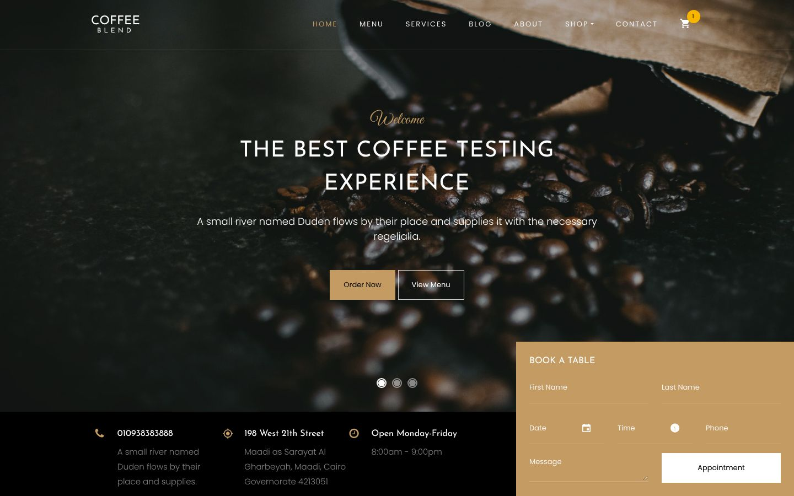
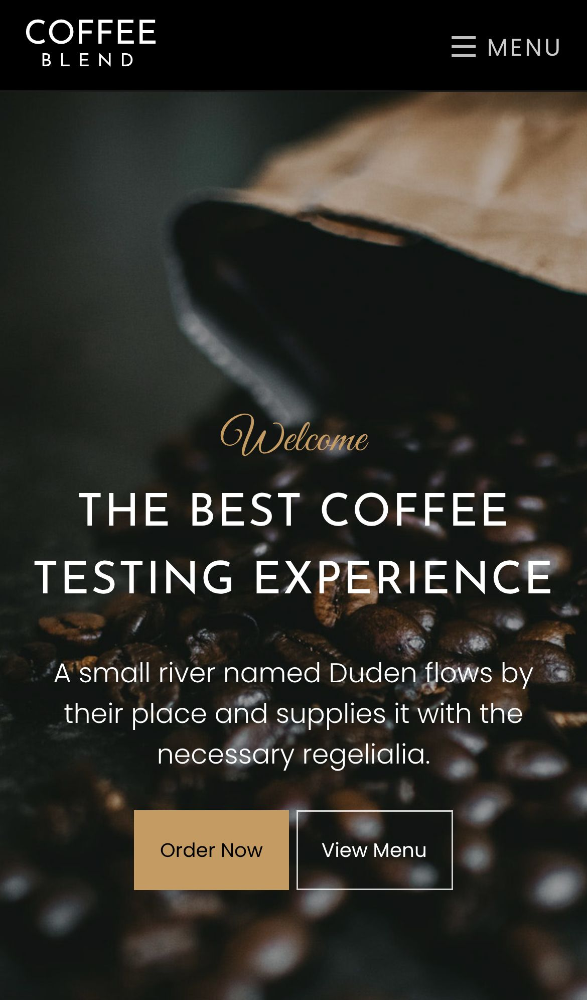
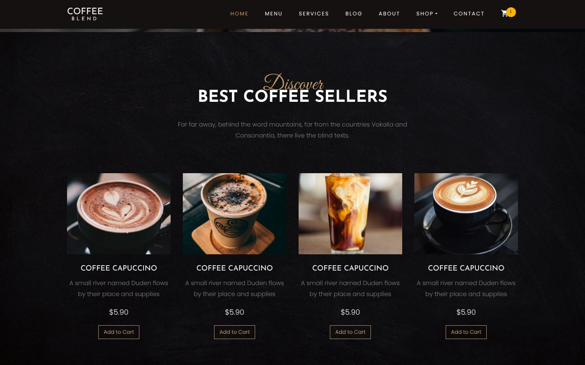
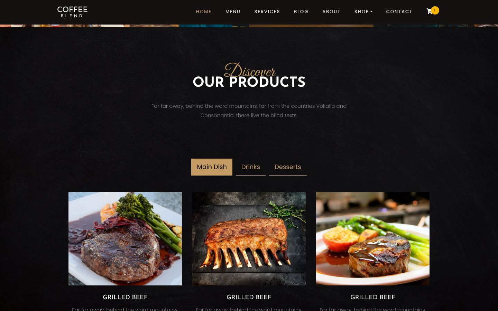

<div align="center">

# Coffee Blend

### Multi-page coffee shop website · HTML · CSS / Sass · jQuery · Bootstrap 4

A responsive coffee shop and restaurant website with a home page, menu, services, blog, about and contact pages, plus shop, product, cart and checkout pages. Built on Colorlib's free "Coffee Blend" template and customised with my own contact details.

[](https://developer.mozilla.org/docs/Web/HTML)
[](https://developer.mozilla.org/docs/Web/CSS)
[](https://sass-lang.com)
[](https://getbootstrap.com)
[](https://jquery.com)
[-555555)](https://colorlib.com)
<br>
[](https://eslamraafat1.github.io/Coffee/)

**[Live demo](https://eslamraafat1.github.io/Coffee/)** ·
**[Portfolio](https://new-portfolio-ashy-xi.vercel.app/)** ·
**[LinkedIn](https://www.linkedin.com/in/eslamraafat-dev/)** ·
**[Email](mailto:eslamraafat736@gmail.com)**

<br>



</div>

<table>
  <tr>
    <td width="33%"></td>
    <td width="67%">
      <br><br>
      
    </td>
  </tr>
  <tr>
    <td align="center"><sub>Mobile (iPhone 13)</sub></td>
    <td align="center"><sub>Best sellers · Product tabs (Main Dish / Drinks / Desserts)</sub></td>
  </tr>
</table>

---

## Contents

- [Overview](#overview)
- [Features](#features)
- [Tech stack](#tech-stack)
- [Pages](#pages)
- [Project structure](#project-structure)
- [Getting started](#getting-started)
- [Deployment](#deployment)
- [Credits](#credits)
- [Author](#author)

## Overview

**Coffee Blend** is a practice project from 2023 in which I worked with a complete multi-page Bootstrap template: Colorlib's free "Coffee Blend" theme (licensed under CC BY 3.0). I set it up as a coffee shop site with my own phone number and a Cairo address, and published it on GitHub Pages.

Most of the copy is still the template's placeholder text, and the shop, cart and checkout pages are static mock-ups (there is no back end).

What I practised:

- Working inside a large existing codebase: a Bootstrap 4 theme with Sass sources (`scss/`) and many jQuery plugins.
- Keeping navigation, header and footer consistent across 11 HTML pages.
- Responsive layouts, booking forms with date and time pickers, and e-commerce page layouts.

## Features

- **Hero slider** (Owl Carousel) with three slides and **Order Now / View Menu** buttons.
- **Contact strip** (phone, address, opening hours) and a **Book a Table** form with date picker and time picker.
- **Our Story**, **Services** and **Our Menu** sections.
- **Animated counters** (jQuery animateNumber + Waypoints) that start when the section scrolls into view.
- **Best Coffee Sellers** product cards with prices and **Add to Cart** buttons.
- **Photo gallery** strip.
- **Our Products** tabs: Main Dish, Drinks and Desserts.
- **Customer testimonials** and **Recent from blog** cards.
- **Parallax backgrounds** (Stellar.js) and scroll-in animations (`ftco-animate` with Waypoints and animate.css).
- **Responsive navbar** that collapses into a "Menu" toggle on mobile, with a Shop dropdown and a cart icon.
- **Page loader** spinner.

## Tech stack

| Layer | Tools |
| --- | --- |
| Markup and styles | HTML5, CSS3, Sass (`scss/style.scss` compiled with Prepros) |
| Framework | Bootstrap 4.1.0 |
| Scripting | jQuery 3.2.1, `js/main.js` |
| Plugins | Owl Carousel, Magnific Popup, Waypoints, Stellar.js (parallax), animateNumber, Scrollax, AOS, bootstrap-datepicker, jquery-timepicker |
| Icons and fonts | Ionicons, Flaticon, Icomoon, Open Iconic, Google Fonts |
| Hosting | GitHub Pages |

## Pages

| Page | File |
| --- | --- |
| Home | [`index.html`](index.html) |
| Menu | [`menu.html`](menu.html) |
| Services | [`services.html`](services.html) |
| Blog / Blog post | [`blog.html`](blog.html), [`blog-single.html`](blog-single.html) |
| About | [`about.html`](about.html) |
| Shop / Single product | [`shop.html`](shop.html), [`product-single.html`](product-single.html) |
| Cart / Checkout | [`cart.html`](cart.html), [`checkout.html`](checkout.html) |
| Contact | [`contact.html`](contact.html) |

## Project structure

```text
.
├── *.html               # 11 pages (see the table above)
├── css/                 # compiled theme CSS + plugin styles
├── scss/                # Sass sources (theme + Bootstrap partials)
├── js/                  # jQuery, Bootstrap and plugins + main.js
├── fonts/               # icon fonts (Ionicons, Flaticon, Icomoon, Open Iconic)
├── images/              # photos and backgrounds
├── prepros-6.config     # Prepros (Sass compiler) project settings
└── docs/screenshots/    # README images
```

## Getting started

No build step is needed to view the site:

```bash
git clone https://github.com/Eslamraafat1/Coffee.git
cd Coffee
npx serve .        # or simply open index.html in a browser
```

To change the styles, edit `scss/style.scss` and compile it to `css/style.css` with Prepros or any Sass compiler.

## Deployment

Deployed with **GitHub Pages** from the `master` branch: [eslamraafat1.github.io/Coffee](https://eslamraafat1.github.io/Coffee/).

## Credits

Design and base code: the free **Coffee Blend** template by [Colorlib](https://colorlib.com), licensed under [CC BY 3.0](https://creativecommons.org/licenses/by/3.0/). Photos come with the template.

## Author

**Eslam Raafat** — Front-End Developer (React · Next.js · TypeScript)

- **Portfolio:** [new-portfolio-ashy-xi.vercel.app](https://new-portfolio-ashy-xi.vercel.app/)
- **LinkedIn:** [linkedin.com/in/eslamraafat-dev](https://www.linkedin.com/in/eslamraafat-dev/)
- **GitHub:** [@Eslamraafat1](https://github.com/Eslamraafat1)
- **Email:** [eslamraafat736@gmail.com](mailto:eslamraafat736@gmail.com)
